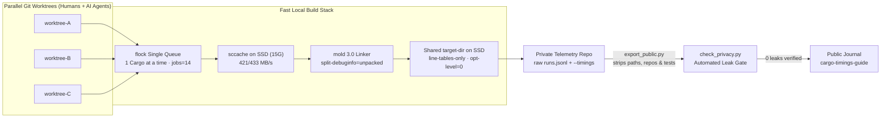

<div align="center">
  
</div>

<p align="center">
  
  
  
  
  
</p>

<p align="center">
  <a href="#editorial-context"><strong>Context</strong></a> ·
  <a href="#headline-benchmarks"><strong>Benchmarks</strong></a> ·
  <a href="#the-five-sizes-of-cargo"><strong>Workload Tiers</strong></a> ·
  <a href="#system-architecture"><strong>Architecture</strong></a> ·
  <a href="#issue-index"><strong>Read the Issues</strong></a> ·
  <a href="#60-second-copy-paste-recipe"><strong>Quick Config</strong></a> ·
  <a href="#reproducible-kit"><strong>Kit</strong></a>
</p>

---

> **An open engineering journal documenting how we cut Rust build & test latency by up to 75% across an 883-package workspace—without a single OOM crash on a swapless 30 GiB workstation and without leaking proprietary code.**

---

<a id="editorial-context"></a>
## 01 · Editorial Context: What We Build & Why Standard Guides Fell Short

Most Rust compile-time tuning guides assume **one developer editing one checkout**. Our production loop operates under very different physics:

| Dimension | Our Reality |
|---|---|
| **Codebase Scale** | Cross-platform Rust desktop + WebAssembly application workspace: **15 internal crates** (UI, layout engine, document core, rendering, PDF/file pipelines, geometry, CLI, `xtask`), **883 packages** in `Cargo.lock`, up to **754 compilation units** in a single heavy build. |
| **Delivery Model** | High-concurrency multi-branch development across **parallel `git worktree` checkouts** driven by autonomous AI coding agents and human reviewers. Every fix ships as an **atomic, single-commit PR**. |
| **Validation Split** | **Local pre-PR (~15–30s):** `fmt` → `clippy` → surgical `nextest --lib` → lightweight `xtask`. **GitHub Actions CI:** owns the full multi-OS (Linux / macOS / Windows) regression matrix. |
| **Hardware Envelope** | 8-core / 16-thread Linux workstation (`Ryzen 7 5700X`), **30.26 GiB RAM with 0 GiB swap**, mixed storage (**SATA SSD ~430 MB/s** vs. **HDDs ~90 MB/s**). |

> [!IMPORTANT]
> When 2–4 coding agents run `cargo` concurrently on a 30 GiB swapless machine, **uncoordinated parallelism does not make builds faster—it triggers the Linux OOM killer**. Every optimization in this journal was measured against real telemetry (`1,091` runs across `14` `env_hash` profiles) rather than guesswork.

---

<a id="headline-benchmarks"></a>
## 02 · Headline Benchmarks: Baseline vs. Final Profile

<p align="center">
  
</p>

| Metric | Baseline (`a6ef96503714`, `n=64`) | Final Active (`9edf022122b2`, `n=640`) | Improvement |
|---|---:|---:|---:|
| **`cargo clippy` Mean** | 63.42s | **15.65s** | **-75.3% (4.1x faster)** |
| **Overall p90 Wall Time** | 117.72s | **58.43s** | **-50.4%** |
| **Overall Mean Wall Time** | 38.00s | **23.08s** | **-39.3%** |
| **`cargo nextest` Median / Mean** | 26.23s / 52.76s | **15.85s / 32.62s** | **-39.6% / -38.2%** |
| **Average Peak RAM** | 1,646 MiB | **1,238 MiB** | **-24.8% (0 OOM kills)** |

*After stabilizing on `9edf022122b2` (day 2, `n=345`), overall mean wall time dropped further to **17.43s**, morning `nextest` median hit **9.33s**, and `sccache` hit rate climbed from **18.0% → 63.8%**.*

---

<a id="the-five-sizes-of-cargo"></a>
## 03 · The Five Sizes of Cargo in Daily Engineering

A single average hides five completely different Cargo workloads. Optimizing blindly for cold builds can easily sabotage your 10-second inner loop:

<p align="center">
  
</p>

| # | Workload Tier | Typical Commands | Runs | Median | p90 | Max | Avg / Peak RAM |
|---|---|---|---:|---:|---:|---:|---:|
| **1** | **Repo Automation** | `cargo xtask layers`, `assets` | 61 | 1.29s | 7.21s | 24.13s | 230 / 267 MiB |
| **2** | **Formatting** | `cargo fmt --all -- --check` | 318 | 3.58s | 3.74s | 20.32s | 151 / 246 MiB |
| **3** | **Focused Iteration** | `clippy -p <crate>`, `nextest --lib <filter>` | 686 | 16.09s | 81.52s | 489.30s | 1,900 / 5,819 MiB |
| **4** | **Full Verification** | `cargo xtask wasm` | 8 | 23.86s | 56.39s | 109.31s | 782 / 887 MiB |
| **5** | **Release Profiling** | `build/run --release --example <probe>` | 18 | 169.07s | 231.61s | 424.70s | 4,416 / 5,826 MiB |

---

<a id="system-architecture"></a>
## 04 · System & Privacy Architecture



### Storage & Linker Controlled Benchmarks

<p align="center">
  
</p>

---

<a id="issue-index"></a>
## 05 · Issue Index (Deep-Dive Articles)

| Issue | Feature Story | Core Findings |
|---|---|---|
| **Issue 01** | [**Context, Workload Taxonomy & The Multi-Agent OOM Problem**](issues/01-context-and-multi-agent-oom.md) | Why `flock` serialization + `jobs = 14` + mandatory `--lib` target filtering beats concurrent Cargo contention on 30 GiB swapless hardware. |
| **Issue 02** | [**Storage & `sccache`: SSD vs. HDD vs. `/dev/shm`**](issues/02-storage-and-sccache-benchmarks.md) | Moving `sccache` from an 87 MB/s HDD to a 421 MB/s SSD cut warm `nextest` loops by **38%** (`12.64s → 7.83s`) and beat `/dev/shm` (`8.01s`) without consuming RAM. |
| **Issue 03** | [**Linker Wars & Profile Tuning (`mold`, `wild`, Incremental)**](issues/03-linker-and-profile-experiments.md) | Controlled A/B data on `mold` vs. `wild`, why `CARGO_INCREMENTAL=0` sabotaged local iteration (`1.6%` cache hits), and how `codegen-units = 256` + `line-tables-only` won. |
| **Issue 04** | [**Publishing Real Cargo Telemetry Without Leaking Private Data**](issues/04-privacy-preserving-cargo-telemetry.md) | Our two-repository architecture, crate-role anonymization map, and automated `check_privacy.py` gate that scans even itself. |

---

<a id="60-second-copy-paste-recipe"></a>
## 06 · The 60-Second Copy-Paste Recipe

Want the winning profile (`9edf022122b2`) right now? Drop [`kit/config.toml`](kit/config.toml) into `~/.cargo/config.toml` (replace `$HOME` with your absolute home path):

```toml
[build]
jobs = 14                                  # 16 threads - 2 reserved for OS/agents (pair with flock)
target-dir = "$HOME/.cache/cargo-target"   # Fast local SSD
rustc-wrapper = "sccache"                  # Cross-worktree compiler cache

[target.x86_64-unknown-linux-gnu]
rustflags = ["-C", "link-arg=-fuse-ld=mold"]

[env]
SCCACHE_DIR = "$HOME/.cache/sccache"       # Keep sccache on SSD, NEVER on spinning HDD
SCCACHE_CACHE_SIZE = "15G"

[profile.dev]
debug = "line-tables-only"
codegen-units = 256
split-debuginfo = "unpacked"

[profile.test]
opt-level = 0
debug = "line-tables-only"
codegen-units = 256
split-debuginfo = "unpacked"
```

<details>
<summary><strong>Click to inspect all 14 tested <code>env_hash</code> profiles</strong></summary>

| `env_hash` | Role | Runs | Mean Wall | p50 | p90 | Avg RAM | Summary |
|---|---|---:|---:|---:|---:|---:|---|
| `a6ef96503714` | Baseline | 64 | 38.00s | 8.04s | 117.72s | 1,646 MiB | `jobs=12`, `debug=1`, `sccache` HDD |
| `b230db7a08ec` | Experiment | 33 | 24.41s | 3.33s | 117.09s | 890 MiB | `line-tables-only` + `INC=0` |
| `a04a0a3bf7a2` | Transition | 1 | 110.20s | 110.20s | 110.20s | 4,591 MiB | `jobs=14` |
| `41a80f22062d` | Experiment | 133 | 29.63s | 7.42s | 79.72s | 1,450 MiB | `cgu=256`, `unpacked`, `INC=0` global |
| `bbd0a3bbe7c0` | Production | 195 | 22.07s | 7.74s | 45.51s | 1,417 MiB | Re-enabled incremental in `dev`/`test` |
| `bee8e280d8aa` | Probe | 1 | 10.07s | 10.07s | 10.07s | 273 MiB | Nightly `-Zcodegen-backend=cranelift` |
| `1439ba1ce595` | Bench B0 | 7 | 53.05s | 17.14s | 124.97s | 2,018 MiB | `[profile.test] opt-level=0`, `sccache` HDD |
| `b7c064c86a33` | Bench B1 | 3 | 14.08s | 12.95s | 16.86s | 1,770 MiB | `sccache` disabled |
| `29de672b6fc0` | Bench B2 | 3 | 8.81s | 9.08s | 9.44s | 1,772 MiB | **`sccache` on SSD (7.83s warm winner)** |
| `af06a50582b4` | Bench B3 | 3 | 122.49s | 9.10s | 281.25s | 2,318 MiB | `codegen-units=64` |
| `751159cacbde` | Bench B4 | 3 | 142.52s | 9.92s | 329.04s | 2,209 MiB | `codegen-units=128` |
| `c431e074d48a` | Bench B5 | 3 | 138.11s | 9.98s | 323.51s | 2,119 MiB | `wild` linker (`clippy` failed) |
| `f4aeb7cc66aa` | Bench B6 | 2 | 191.68s | 191.68s | 338.62s | 2,596 MiB | `CARGO_TARGET_DIR=/dev/shm` |
| **`9edf022122b2`** | **Active Final** | **640** | **23.08s** | **7.91s** | **58.43s** | **1,238 MiB** | **Stabilized SSD `sccache` + `mold` + `opt-level=0`** |

</details>

---

<a id="reproducible-kit"></a>
## 07 · Reproducible Kit & Open Telemetry

Everything needed to reproduce our benchmarks or run the same telemetry pipeline on your own machine:

| File | Purpose |
|---|---|
| [`kit/config.toml`](kit/config.toml) | Portable `~/.cargo/config.toml` template ready for Linux workstations |
| [`kit/cargo-timed-lite.sh`](kit/cargo-timed-lite.sh) | Lightweight `flock` queue + wall-time/RAM JSONL logger (~30 lines of Bash) |
| [`kit/analyze.py`](kit/analyze.py) | Computes `p50`, `mean`, `p90`, `max`, RSS, and `sccache` hit rate over `runs-public.jsonl` |
| [`scripts/generate_charts.py`](scripts/generate_charts.py) | Regenerates all vector SVG charts directly from `data/summary.json` |
| [`scripts/check_privacy.py`](scripts/check_privacy.py) | Automated leak scanner (generic path/PR regex + external private denylist) |
| [`data/summary.json`](data/summary.json) & [`data/runs-public.jsonl`](data/runs-public.jsonl) | Full anonymized dataset (`1,091` real Cargo runs) |

```bash
# Inspect the live anonymized dataset locally
python3 kit/analyze.py

# Filter only focused test/clippy runs
python3 kit/analyze.py --scope focused

# Verify zero privacy leaks before publishing
python3 scripts/check_privacy.py
```
