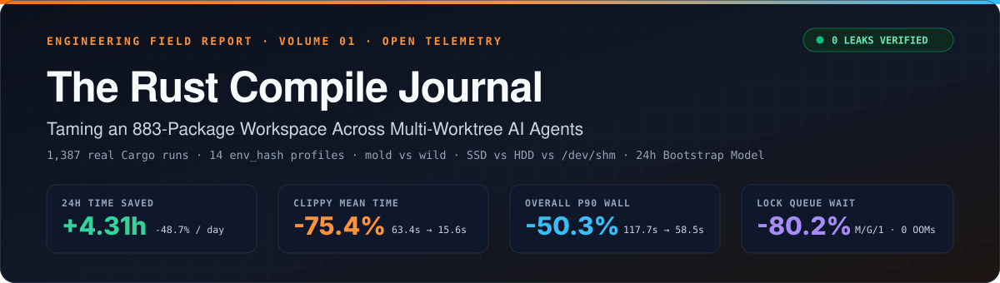
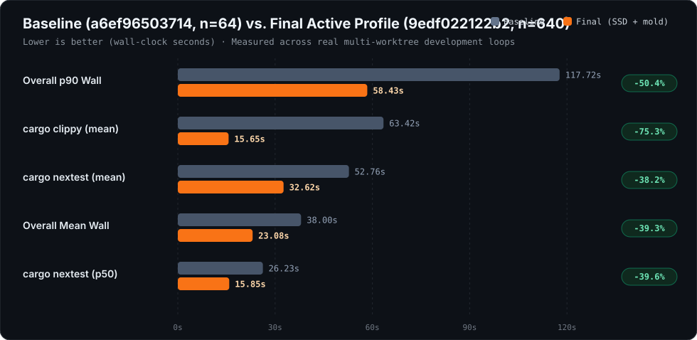
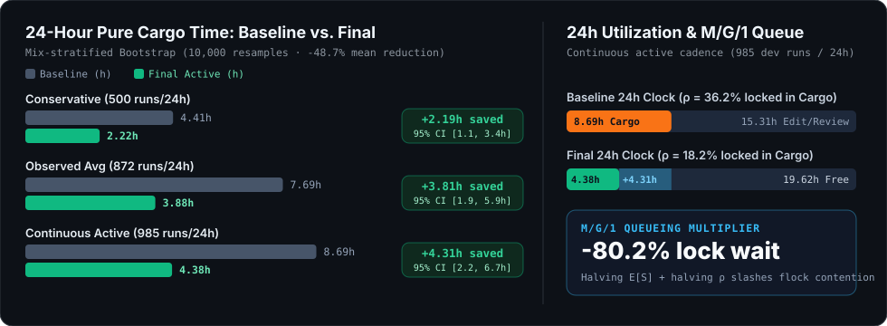
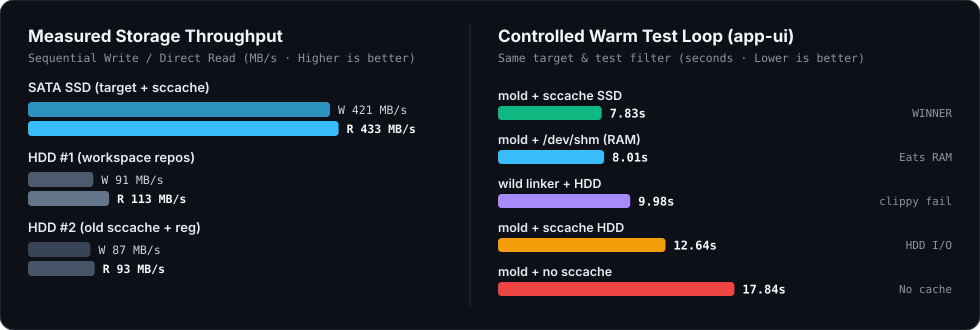

<div align="center">
  
</div>

<p align="center">
  
  
  
  
  
  
</p>

<h3 align="center">
  What happens when parallel AI coding agents compile an 883-package Rust workspace on a 30 GiB swapless machine?
</h3>

<p align="center">
  <strong>This open engineering journal documents 14 real Cargo profiles, 1,102 instrumented builds, and a stratified 24-hour statistical model showing how we recovered <code>+4.31 hours/day</code> of pure compile time with <code>0 OOM crashes</code> and <code>0 private leaks</code>.</strong>
</p>

---

## Visual Highlights

<p align="center">
  
</p>

<p align="center">
  
</p>

<p align="center">
  
</p>

---

## Table of Contents · Read the Issues

Each issue is a self-contained, deeply technical field report backed by verifiable telemetry in [`data/`](data/):

| Issue | Feature Story | Inside This Issue |
|---|---|---|
| **01** | [**Project Context, Five Cargo Sizes & The Multi-Agent OOM Problem**](issues/01-context-and-multi-agent-oom.md) | Full workspace anatomy (`15` internal crates, `883` lock packages, up to `754` build units), delivery model, the 5 Cargo workload tiers, `flock` single-queue architecture, `--lib` filtering, and all 14 tested `env_hash` profiles. |
| **02** | [**Storage & `sccache`: SSD vs. HDD vs. `/dev/shm`**](issues/02-storage-and-sccache-benchmarks.md) | Measured disk throughput (`421/433 MB/s` SSD vs `87/93 MB/s` HDD), controlled B0–B6 benchmarks, why `/dev/shm` lost on 30 GiB hosts, and how SSD caching cut warm `nextest` to **7.83s**. |
| **03** | [**Linker Wars, Profile Tuning & Copy-Paste Config**](issues/03-linker-and-profile-experiments.md) | `mold 3.0` vs. `wild`, why `CARGO_INCREMENTAL=0` backfired locally (`1.6%` hit rate), `codegen-units` (`16` vs `64` vs `128` vs `256`), `line-tables-only`, `split-debuginfo = "unpacked"`, and the line-by-line `~/.cargo/config.toml` recipe. |
| **04** | [**24-Hour Statistical Savings & $M/G/1$ Queueing Model**](issues/04-24h-statistical-savings-model.md) | Mix-stratified Bootstrap (`10,000` resamples, 95% CI) isolating pure Cargo wall-time gains across 24 hours (**+2.19h to +4.31h saved/day**), compiler utilization ($\rho$: `36.2% → 18.2%`), and why lock contention drops **~80%**. |
| **05** | [**Privacy-Preserving Telemetry & Reproducible Kit**](issues/05-privacy-preserving-cargo-telemetry.md) | How to publish real Cargo telemetry without leaking repos, paths, or tests (`export_public.py` + self-scanning `check_privacy.py`), plus how to run our portable scripts on your own machine. |

---

## Quick Start · Reproduce Everything Locally

```bash
# 1. Inspect the anonymized telemetry dataset (1,102 real Cargo runs)
python3 kit/analyze.py

# 2. Re-run the 10,000-iteration 24-hour stratified bootstrap model
python3 kit/model_24h.py

# 3. Drop our winning profile into ~/.cargo/config.toml
cat kit/config.toml

# 4. Run the automated privacy leak gate
python3 scripts/check_privacy.py
```

<p align="center">
  <sub><strong>Kit &amp; Data:</strong> <a href="kit/config.toml">config.toml</a> · <a href="kit/cargo-timed-lite.sh">cargo-timed-lite.sh</a> · <a href="kit/analyze.py">analyze.py</a> · <a href="kit/model_24h.py">model_24h.py</a> · <a href="data/summary.json">summary.json</a> · <a href="data/runs-public.jsonl">runs-public.jsonl</a></sub>
</p>
