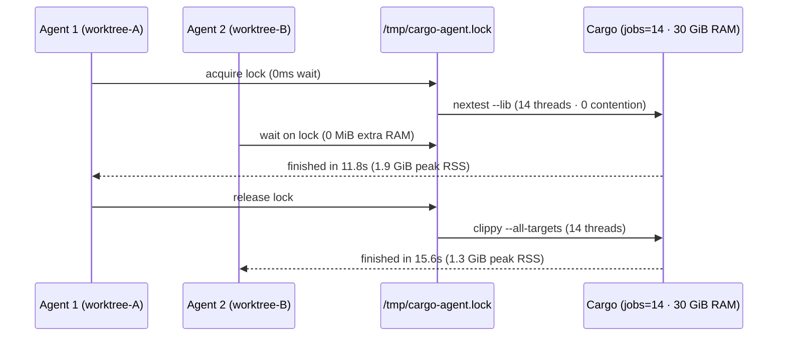

<p align="center">
  <a href="../README.md">← Cover</a> ·
  <strong>Issue 01</strong> ·
  <a href="02-storage-and-sccache-benchmarks.md">Issue 02</a> ·
  <a href="03-linker-and-profile-experiments.md">Issue 03</a> ·
  <a href="04-24h-statistical-savings-model.md">Issue 04</a> ·
  <a href="05-privacy-preserving-cargo-telemetry.md">Issue 05 →</a>
</p>

# Issue 01 · Project Context, Five Cargo Sizes & The Multi-Agent OOM Problem

> *Why conventional single-developer Rust guides break down under parallel AI coding agents—and how `flock` serialization, `jobs = 14`, and `--lib` filtering eliminated OOM crashes across 1,102 runs.*

---

## 1 · Anatomy of the Project & Delivery Model

Before optimizing a single flag, you have to understand the **shape of the workload**. Our benchmark data comes from a real, active production engineering environment:

- **Application Domain & Architecture:** A cross-platform Rust desktop and WebAssembly application workspace composed of **15 internal crates** covering UI (`app-ui`), core editing/state engine (`app-engine`), text/document layout (`app-layout`), 2D/GPU rendering (`app-render`), PDF/document serialization (`app-pdf`, `app-doc`, `app-docx`), geometry (`app-geom`), CLI (`app-cli`), WebAssembly targets (`app-wasm`), and workspace automation (`xtask`).
- **Dependency Graph Scale:** **`883` packages** in `Cargo.lock`, expanding to **up to `754` compilation units** in a single heavy UI/test build (across 415 recorded `--timings` unit bundles: min `1`, median `16`, max `754` units).
- **Delivery Workflow:** Instead of one developer working linearly on one checkout, multiple **parallel `git worktree` checkouts** are active simultaneously—driven by autonomous AI coding agents implementing issues, addressing code reviews, and rebasing conflicts alongside human review.
- **Atomic PR Cadence:** Every task targets **1 problem = 1 atomic, single-commit PR**. Local validation must finish in **~15–30 seconds**; full cross-platform regression suites (Linux, macOS, Windows) are delegated to GitHub Actions CI.
- **Workstation Hardware Envelope:**
  - **CPU:** 8-core / 16-thread desktop CPU (`Ryzen 7 5700X`, `performance` governor, up to `4.67 GHz`).
  - **Memory:** **`30.26 GiB` physical RAM with `0.0 GiB` swap** (hard OOM ceiling—zero swap cushion).
  - **Storage:** Mixed tier—1 fast local **SATA SSD (`421 / 433 MB/s`)** + 2 **spinning HDDs (`87–113 MB/s`)**.

---

## 2 · The Five Sizes of Cargo in Daily Engineering

One of the biggest mistakes in Rust build tuning is treating "Cargo build time" as a single number. Across **`1,102` instrumented runs**, our workload naturally splits into **five completely different operational tiers**:

<p align="center">
  
</p>

| Tier | Scope | Representative Commands | Runs | Median | Mean | p90 | Max | Avg / Peak RAM |
|---|---|---|---:|---:|---:|---:|---:|---:|
| **1** | `xtask` | `cargo xtask layers`, `assets` | 63 | 1.28s | 3.02s | 6.97s | 24.13s | 231 / 267 MiB |
| **2** | `fmt` | `cargo fmt --all -- --check` | 321 | 3.59s | 3.98s | 3.73s | 20.32s | 151 / 246 MiB |
| **3** | `focused` | `clippy -p <crate>`, `nextest/test --lib <filter>` | 692 | 16.09s | 34.83s | 81.25s | 489.30s | 1,899 / 5,819 MiB |
| **4** | `full` | `cargo xtask wasm` | 8 | 23.86s | 30.03s | 56.39s | 109.31s | 782 / 887 MiB |
| **5** | `other` | `build/run --release --example <probe>` | 18 | 169.07s | 153.82s | 231.61s | 424.70s | 4,416 / 5,826 MiB |

Notice the massive asymmetry:
- **93% of all runs** are Tiers 1–3 (`fmt`, `xtask`, `focused`). Cutting even 15 seconds off Tier 3 compounds hundreds of times per day.
- **Tier 3 and Tier 5 spike to `5.8 GiB` RSS per Cargo invocation.** If 3–5 worktrees trigger Cargo simultaneously, combined RSS + linker memory + OS page cache breaches `30 GiB` and triggers the Linux OOM killer.

---

## 3 · Why Parallel Cargo Fails (and How `flock` Fixes It)

Many teams respond to multi-agent OOMs by capping every agent to `jobs = 4`. That is the worst of both worlds:
- When only 1 agent is compiling (which is most of the time once builds are fast), **75% of your CPU sits idle**.
- When 4 agents compile at once, they still thrash the shared `target-dir` lock, duplicate `rustc` memory overhead, and contend on disk I/O.

Instead, we invert the model: **1 Cargo process at a time, running at near-full throttle (`jobs = 14`)**, enforced via a single `flock /tmp/cargo-agent.lock` wrapper:



- Leaving **2 of 16 threads free** (`jobs = 14`) keeps the desktop, editor, `rust-analyzer`, and agent runtimes completely responsive.
- **Result:** **0 OOM kills** across `1,102` runs, with average peak RSS dropping **25%** (`1,646 MiB → 1,235 MiB`).

---

## 4 · The Hidden +100s Penalty: Always Pass `--lib`

> [!WARNING]
> In crates that declare examples, benchmarks, or integration tests (`tests/*.rs`), running `cargo nextest run -p app-ui -E 'test(my_test)'` **without `--lib`** forces Cargo to compile and link **every integration test and example binary** (`ui_shot`, `perf_probe`, `it`, etc.)—adding **100+ seconds** of wasted compilation even when running a single unit test!

**Mandatory local rule:**
```bash
# Fast (9–16s): builds ONLY the crate's library unit-test binary
cargo nextest run -p app-ui --lib module::tests::specific_regression

# Only omit --lib when explicitly targeting an integration test or example:
cargo nextest run -p app-cli --test cli_integration
```

---

## 5 · Complete Catalog of All 14 Tested `env_hash` Profiles

Every configuration change automatically hashes `~/.cargo/config.toml`, toolchain versions, and environment variables into a deterministic `env_hash`:

| `env_hash` | Stage | Runs | Mean Wall | p50 | p90 | Avg RAM | What Changed |
|---|---|---:|---:|---:|---:|---:|---|
| `a6ef96503714` | Baseline | 64 | 38.00s | 8.04s | 117.72s | 1,646 MiB | `jobs=12`, `debug=1`, `mold`, `sccache` HDD (`25G`) |
| `b230db7a08ec` | Exp 01 | 33 | 24.41s | 3.33s | 117.09s | 890 MiB | `debug="line-tables-only"` + `CARGO_INCREMENTAL=0` |
| `a04a0a3bf7a2` | Exp 02 | 1 | 110.20s | 110.20s | 110.20s | 4,591 MiB | Bumped `jobs=12 -> 14` |
| `41a80f22062d` | Exp 03 | 133 | 29.63s | 7.42s | 79.72s | 1,450 MiB | `codegen-units=256`, `split-debuginfo="unpacked"`, `INC=0` |
| `bbd0a3bbe7c0` | Exp 04 | 195 | 22.07s | 7.74s | 45.51s | 1,417 MiB | Removed global `CARGO_INCREMENTAL=0` |
| `bee8e280d8aa` | Probe | 1 | 10.07s | 10.07s | 10.07s | 273 MiB | Nightly `-Zcodegen-backend=cranelift` probe |
| `1439ba1ce595` | Bench B0 | 7 | 53.05s | 17.14s | 124.97s | 2,018 MiB | `[profile.test] opt-level=0`, `sccache` HDD |
| `b7c064c86a33` | Bench B1 | 3 | 14.08s | 12.95s | 16.86s | 1,770 MiB | `sccache` completely disabled |
| `29de672b6fc0` | Bench B2 | 3 | 8.81s | 9.08s | 9.44s | 1,772 MiB | **`sccache` moved to SSD (`15G`) — 7.83s winner** |
| `af06a50582b4` | Bench B3 | 3 | 122.49s | 9.10s | 281.25s | 2,318 MiB | `[profile.test] codegen-units=64` |
| `751159cacbde` | Bench B4 | 3 | 142.52s | 9.92s | 329.04s | 2,209 MiB | `[profile.test] codegen-units=128` |
| `c431e074d48a` | Bench B5 | 3 | 138.11s | 9.98s | 323.51s | 2,119 MiB | `wild` linker (`clippy` failed) |
| `f4aeb7cc66aa` | Bench B6 | 2 | 191.68s | 191.68s | 338.62s | 2,596 MiB | `CARGO_TARGET_DIR=/dev/shm` (RAM disk) |
| **`9edf022122b2`** | **Production** | **651** | **22.95s** | **7.77s** | **58.48s** | **1,235 MiB** | **Final winning profile (SSD `sccache` + `mold` + `opt-level=0`)** |

---

<p align="center">
  <a href="../README.md">← Back to Cover</a> ·
  <a href="02-storage-and-sccache-benchmarks.md">Next: Issue 02 — Storage &amp; sccache Benchmarks →</a>
</p>
