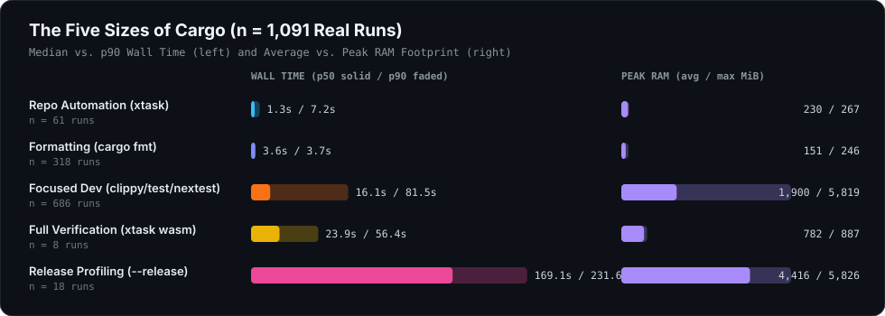
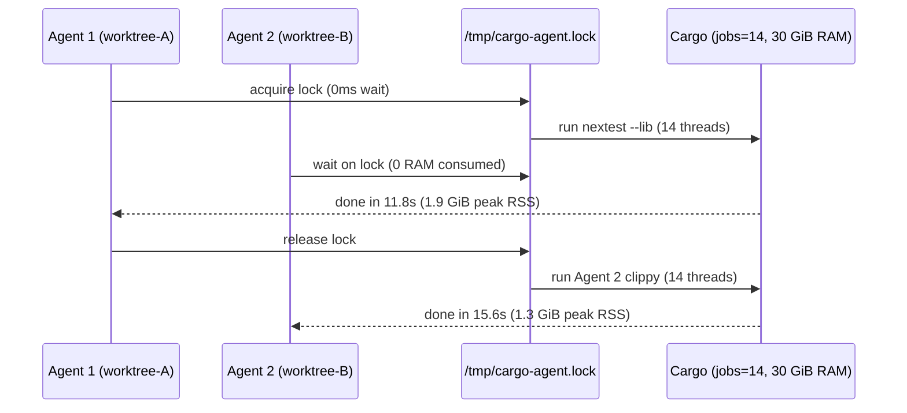

<p align="center">
  <a href="../README.md">← Cover</a> ·
  <strong>Issue 01</strong> ·
  <a href="02-storage-and-sccache-benchmarks.md">Issue 02</a> ·
  <a href="03-linker-and-profile-experiments.md">Issue 03</a> ·
  <a href="04-privacy-preserving-cargo-telemetry.md">Issue 04 →</a>
</p>

# Issue 01 · Context, Workload Taxonomy & The Multi-Agent OOM Problem

> *Why serializing Cargo with `flock` + `jobs = 14` beat parallel chaos on a 30 GiB swapless machine.*

---

## The Multi-Worktree Reality

When multiple AI coding agents and human developers share a single **30.26 GiB RAM (0 GiB swap)** Linux workstation across parallel `git worktree` checkouts, the #1 failure mode is not slow compilation—it is **simultaneous Cargo contention**:

1. **Silent OOM Kills:** Two `cargo nextest` or `rustc` invocations running concurrently can easily spike past 10–15 GiB RSS each, hitting the kernel OOM killer immediately when swap is `0 GiB`.
2. **Thread Starvation:** Saturating all 16 hardware threads (`jobs = 16`) starves the OS, IDE, `rust-analyzer`, and active agent processes.
3. **Hidden Target Bloat:** Running `cargo nextest run -p app-ui` *without* `--lib` compiles every integration test binary and example (`ui_shot`, `perf_probe`, etc.), adding **~100+ seconds** to what should be a 10-second unit check.

<p align="center">
  
</p>

---

## Solution 1 · Single-Queue Serialization (`flock`) + `jobs = 14`

Instead of throttling `jobs` down to `4` per agent (which slows down *every* run even when the machine is idle), we keep **`jobs = 14`** (leaving 2 of 16 threads for the OS/agents) and enforce a **single global FIFO queue** via `flock /tmp/cargo-agent.lock`:



- **Zero OOM crashes** across `1,091` runs—even with `5.8 GiB` peak RSS during `--release` profiling builds.
- Drop-in script included in [`kit/cargo-timed-lite.sh`](../kit/cargo-timed-lite.sh).

---

## Solution 2 · Surgical Target Filtering (`--lib`)

> [!TIP]
> Always pass `--lib` to `cargo nextest run` and `cargo test` unless you explicitly intend to compile an integration test (`--test <name>`) or example (`--example <name>`).

In a multi-target UI crate containing >840 unit tests alongside integration and screenshot harnesses, omitting `--lib` forces Cargo to build and link extra binaries even when filtering down to a single test name:

```bash
# Fast (~9–16s): compiles ONLY the library unit-test binary
cargo nextest run -p app-ui --lib module::tests::specific_regression

# Slow (+100s penalty): compiles lib + integration tests + examples
cargo nextest run -p app-ui -E 'test(specific_regression)'
```

---

## Solution 3 · Decoupled Local vs. CI Validation

| Stage | Where it runs | Target Latency | Scope |
|---|---|---:|---|
| **Inner Dev Loop** | Local workstation | **8–20s** | Single crate `--lib` unit test |
| **Pre-PR Gate** | Local workstation | **15–30s** | `fmt --check` + `clippy -p <crate> -D warnings` + focused `--lib` + `xtask layers` |
| **Full Matrix** | GitHub Actions CI | Minutes (async) | Full workspace tests across Linux, macOS, and Windows |

---

<p align="center">
  <a href="../README.md">← Back to Cover</a> ·
  <a href="02-storage-and-sccache-benchmarks.md">Next: Issue 02 — Storage &amp; sccache →</a>
</p>
