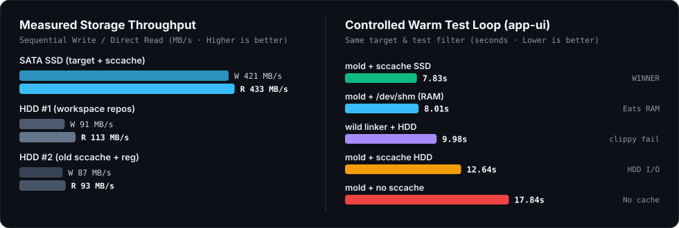

  <a href="../README.md">← Cover</a> ·
  <a href="01-context-and-multi-agent-oom.md">Issue 01</a> ·
  <strong>Issue 02</strong> ·
  <a href="03-linker-and-profile-experiments.md">Issue 03</a> ·
  <a href="04-privacy-preserving-cargo-telemetry.md">Issue 04 →</a>

# Issue 02 · Storage & `sccache`: SSD vs. HDD vs. `/dev/shm`

> *Why putting `sccache` on a spinning HDD sabotaged our hot test loop—and why `/dev/shm` wasn't worth the RAM.*

---

## Measured Storage Tiers

Before moving caches, we measured raw sequential write and direct read throughput on every disk tier in the workstation:

| Storage Role | Disk Tier | Sequential Write | Direct Read | Relative Speed |
|---|---|---:|---:|---:|
| `target_dir_ssd` | Local SATA SSD | **421.0 MB/s** | **433.0 MB/s** | **4.7x faster** |
| `workspace_repos` | Spinning HDD #1 | 91.0 MB/s | 113.0 MB/s | 1.2x |
| `sccache_and_registry` | Spinning HDD #2 | 87.0 MB/s | 93.0 MB/s | 1.0x (baseline) |

Originally, `SCCACHE_DIR` (`25G`) lived on HDD #2 to "preserve SSD write endurance." Our controlled benchmarks proved that decision was costing us seconds on every single edit.

---

## Controlled Benchmark Results (`app-ui`)

  

We executed identical `clippy --all-targets` + `nextest --lib` runs on `app-ui` (keeping `mold 3.0.0`, `jobs = 14`, `codegen-units = 256`, and `[profile.test] opt-level = 0` constant):

| `env_hash` | Storage Configuration | `clippy` | `nextest` (1st / 2nd) | Verdict |
|---|---|---:|---:|---|
| `1439ba1ce595` | `target-dir` SSD, `sccache` **HDD (`25G`)** | 9.68s | 73.10s / 12.64s | HDD latency drags warm loop |
| `b7c064c86a33` | `target-dir` SSD, **`sccache` disabled** | 12.95s | 11.45s / 17.84s | Worse `clippy` & warm loop |
| **`29de672b6fc0`** | `target-dir` SSD, **`sccache` SSD (`15G`)** | **9.53s** | **9.08s / 7.83s** | **Winner (7.83s warm)** |
| `f4aeb7cc66aa` | `CARGO_TARGET_DIR=/dev/shm` (**RAM**), `sccache` HDD | — | 375.36s (cold) / 8.01s | Ties SSD in warm, wastes RAM |

---

## Key Takeaways

> [!IMPORTANT]
> **Rule of Thumb:** Put **`target-dir` AND `SCCACHE_DIR`** on SSD. Keep **`~/.cargo/registry` and `~/.cargo/git`** on HDD if you want to save SSD capacity.

1. **SSD `sccache` cut warm `nextest` by 38%:** Dropping from **12.64s** (HDD) to **7.83s** (SSD) while keeping a modest `15G` cap (`SCCACHE_CACHE_SIZE = "15G"`).
2. **RAM disks (`/dev/shm`) lose on 30 GiB swapless hosts:** At **8.01s**, `/dev/shm` didn't even beat our SATA SSD (**7.83s**), yet consumed gigabytes of physical RAM needed by `rustc` and `mold`.
3. **Cache stability matters:** Once we stopped churning `env_hash` configs on day 2, `sccache` hit rate jumped from **18.0% → 63.8%**.

---

  <a href="01-context-and-multi-agent-oom.md">← Issue 01</a> ·
  <a href="../README.md">Cover</a> ·
  <a href="03-linker-and-profile-experiments.md">Next: Issue 03 — Linker Wars &amp; Profiles →</a>

