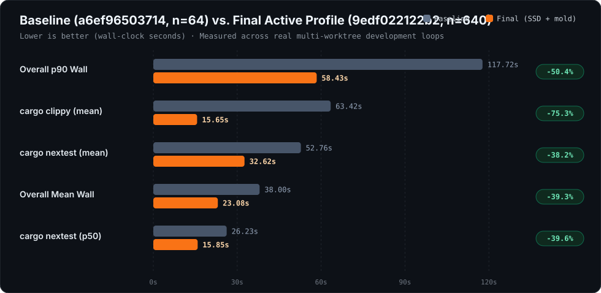

<p align="center">
  <a href="../README.md">← Cover</a> ·
  <a href="01-context-and-multi-agent-oom.md">Issue 01</a> ·
  <a href="02-storage-and-sccache-benchmarks.md">Issue 02</a> ·
  <strong>Issue 03</strong> ·
  <a href="04-24h-statistical-savings-model.md">Issue 04</a> ·
  <a href="05-privacy-preserving-cargo-telemetry.md">Issue 05 →</a>
</p>

# Issue 03 · Linker Wars, Profile Tuning & The Complete Config Recipe

> *Controlled A/B results on `mold` vs. `wild`, why `CARGO_INCREMENTAL = "0"` backfired in local dev, and the exact `~/.cargo/config.toml` that cut `clippy` by 75%.*

---

## 1 · Linker Showdown: `mold 3.0` vs. `wild`

Linking massive Rust test binaries (especially GUI crates pulling hundreds of dependencies) is notoriously single-threaded with GNU `ld`. We already used `mold 3.0.0` in our baseline and tested whether the newer Rust-native `wild` linker could push warm link latency even lower:

| `env_hash` | Linker | `clippy --all-targets` | `nextest` (cold) | `nextest` (warm) | Warm RAM |
|---|---|---:|---:|---:|---:|
| **`29de672b6fc0`** | **`mold 3.0.0`** (+ SSD `sccache`) | **9.53s (PASS)** | — | **7.83s** | **1,949 MiB** |
| `c431e074d48a` | `wild` (`-B<wild-bin>`) | 2.46s (**FAILED**) | 401.90s | 9.98s | 2,956 MiB |

> [!WARNING]
> In our controlled test on `app-ui`, `wild` caused `clippy --all-targets` to fail (`exit_code != 0`), used **~1 GiB more RAM** on the warm link (`2,956` vs `1,949 MiB`), and ran **+2.15s slower** (`9.98s` vs `7.83s`). **`mold 3.0` remains the clear winner for daily production use on Linux.**

---

## 2 · The `CARGO_INCREMENTAL = "0"` Trap in Local Development

Every `sccache` tutorial warns that `sccache` cannot cache `rustc` invocations when incremental compilation is enabled—so developers routinely add `CARGO_INCREMENTAL = "0"` globally in `~/.cargo/config.toml`.

We tested that hypothesis across **nearly 1,000 real runs** and proved it is **counterproductive for local iterative development**:

| `env_hash` | Incremental Mode | Runs | `sccache` Hit Rate | `nextest` Mean | `nextest` Median | `test` Mean |
|---|---|---:|---:|---:|---:|---:|
| `41a80f22062d` | `CARGO_INCREMENTAL = "0"` (global) | 133 | **1.6%** (`35 / 2,193`) | 61.91s | 44.23s | 72.28s |
| `bbd0a3bbe7c0` | Incremental **ON** (`dev`/`test`) | 195 | 2.4% (`31 / 1,239`) | 40.31s | 17.44s | 62.77s |
| **`9edf022122b2`** | **Incremental ON + SSD `sccache` + `opt-level=0`** | **651** | **39.6%** *(Day 2: **63.8%**)* | **32.62s** | **15.85s** | **18.01s** |

### Why Did Global `CARGO_INCREMENTAL = "0"` Backfire?
1. **Local edits invalidate the whole crate:** When you edit a single line inside a large crate like `app-ui` or `app-engine`, `CARGO_INCREMENTAL = "0"` throws away all intra-crate incremental state and forces LLVM to re-codegen the *entire* crate—causing a guaranteed `sccache` miss on every edit.
2. **Silent `codegen-units` collapse:** Worse, when `CARGO_INCREMENTAL = "0"` is active, `rustc` silently drops default `codegen-units` from **`256` down to `16`**, cutting internal LLVM parallelism by 16x unless you explicitly override it!

**Correct rule:** Use `CARGO_INCREMENTAL = "0"` in **ephemeral CI runners** (where incremental state doesn't survive anyway), **not** globally on a local workstation where you iterate in-place.

---

## 3 · Compiler Profile Levers: `codegen-units`, `debug`, `split-debuginfo`, `opt-level`

### `codegen-units`: `64` vs `128` vs `256`
We benchmarked `[profile.test] codegen-units` on `app-ui`:
- `codegen-units = 64` (`af06a50582b4`): cold `349.29s`, warm `9.08s`
- `codegen-units = 128` (`751159cacbde`): cold `408.82s`, warm `9.92s`
- **`codegen-units = 256` (`29de672b6fc0` / `9edf022122b2`):** warm **`7.83s`**, highest LLVM parallelism on 14 threads.

### `debug = "line-tables-only"` + `split-debuginfo = "unpacked"`
- Full DWARF variable info (`debug = 2` or even `debug = 1`) bloats object files, link time, and disk writes.
- Switching both `[profile.dev]` and `[profile.test]` to `debug = "line-tables-only"` + `split-debuginfo = "unpacked"` keeps **complete file names and line numbers in panic backtraces** while cutting heavy UI build disk output (`fs_out`) by **~36%** (`8.83M → 5.67M` blocks).

### `[profile.test] opt-level = 0`
Explicitly pinning `opt-level = 0` in `[profile.test]` guarantees that workspace overrides cannot accidentally drag LLVM optimization passes into unit-test compilation.

<p align="center">
  
</p>

---

## 4 · The Complete Annotated `~/.cargo/config.toml` Recipe

Drop [`kit/config.toml`](../kit/config.toml) into `~/.cargo/config.toml` (replacing `$HOME` with your absolute home path):

```toml
[build]
# 16 hardware threads minus 2 reserved for OS/IDE/agents.
# Pair with `flock` serialization (1 Cargo at a time) to guarantee 0 OOMs on 30 GiB RAM.
jobs = 14

# Shared target directory on your fastest local SSD (never HDD, never /dev/shm on <=32 GiB).
target-dir = "$HOME/.cache/cargo-target"

# Global compiler cache for dependencies and unchanged crates across git worktrees.
rustc-wrapper = "sccache"

[target.x86_64-unknown-linux-gnu]
# Parallel linker: replaces GNU ld with mold.
rustflags = ["-C", "link-arg=-fuse-ld=mold"]

[env]
# CRITICAL: Keep sccache on SSD with a sensible size cap.
SCCACHE_DIR = "$HOME/.cache/sccache"
SCCACHE_CACHE_SIZE = "15G"

[profile.dev]
debug = "line-tables-only"
codegen-units = 256
split-debuginfo = "unpacked"

[profile.test]
opt-level = 0
debug = "line-tables-only"
codegen-units = 256
split-debuginfo = "unpacked"
```

---

<p align="center">
  <a href="02-storage-and-sccache-benchmarks.md">← Issue 02</a> ·
  <a href="../README.md">Cover</a> ·
  <a href="04-24h-statistical-savings-model.md">Next: Issue 04 — 24-Hour Statistical Savings Model →</a>
</p>
