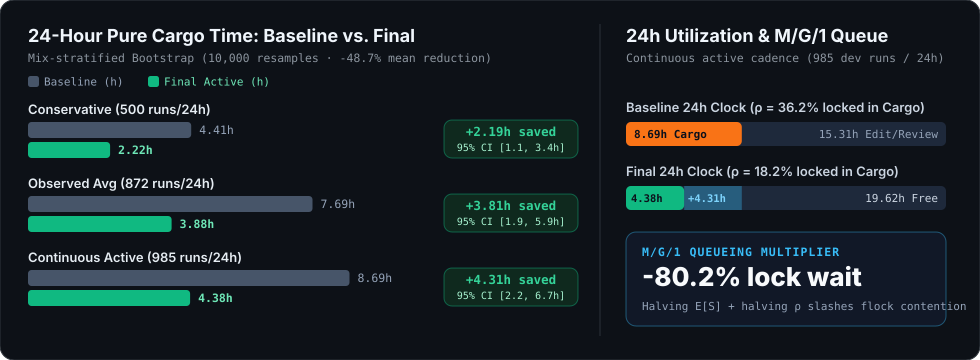

<p align="center">
  <a href="../README.md">← Cover</a> ·
  <a href="01-context-and-multi-agent-oom.md">Issue 01</a> ·
  <a href="02-storage-and-sccache-benchmarks.md">Issue 02</a> ·
  <a href="03-linker-and-profile-experiments.md">Issue 03</a> ·
  <strong>Issue 04</strong> ·
  <a href="05-privacy-preserving-cargo-telemetry.md">Issue 05 →</a>
</p>

# Issue 04 · 24-Hour Statistical Savings & $M/G/1$ Queueing Model

> *How much pure wall-clock time does this configuration actually give back over a 24-hour multi-agent run—stripping out editing, thinking, and timer waits?*

---

## 1 · Why Naive Averages Lie (And How We Control for Command Mix)

A common analytical error is taking the raw overall mean of Day 1 vs. Day 2 and multiplying by 24 hours. That fails because the **command mix** (`fmt`, `clippy`, `nextest`, `test`, `xtask`, `--release`) shifts from hour to hour: if Day 2 ran more `fmt` checks and fewer `--release` builds, a naive average overstates the speedup.

To measure the **true, apples-to-apples 24-hour compile-time savings**, we built [`kit/model_24h.py`](../kit/model_24h.py) using a **Mix-Stratified Non-Parametric Bootstrap (`10,000` resamples, 95% confidence interval)**:

1. **Isolate the daily development loop** (`fmt`, `xtask`, `clippy`, `test`, `nextest` — excluding one-off `--release` profiling spikes so both profiles share the exact same command universe).
2. **Fix the empirical command weights** from our stabilized production loop:
   - `fmt`: **31.7%** · `nextest`: **26.7%** · `clippy`: **21.7%** · `test`: **11.5%** · `xtask`: **8.4%**
3. **Resample with replacement (`10,000` iterations)** within each subcommand stratum for both **Baseline (`a6ef96503714`)** and **Final Active (`9edf022122b2`)**, computing the exact mix-weighted expected time per run:
   $$E[T] = \sum_{s \in \text{subs}} w_s \cdot \bar{T}_s$$
4. **Scale to three realistic 24-hour cadences** calibrated directly from our **29.35 hours of continuous observation** (`1,102` total runs across `26` active hours; peak observed 24h rolling window = **`975` runs**).

---

## 2 · 24-Hour Projection Results (10,000 Bootstrap Resamples)

<p align="center">
  
</p>

| 24-Hour Cadence Scenario | Dev Runs / 24h | Baseline Cargo Time | Final Cargo Time | **Pure Time Saved / 24h** | **95% Bootstrap CI** | Reduction |
|---|---:|---:|---:|---:|---:|---:|
| **Conservative** *(light day)* | 500 | 4.41h | 2.22h | **+2.19h (`2h 11m`)** | `[1.10h, 3.38h]` | **-48.7%** |
| **Observed 24h Average** *(29.35h span)* | **872** | **7.69h** | **3.88h** | **+3.81h (`3h 49m`)** | **`[1.91h, 5.90h]`** | **-48.7%** |
| **Continuous 24h Active Pace** *(41 runs/active h)* | **985** | **8.69h** | **4.38h** | **+4.31h (`4h 19m`)** | **`[2.16h, 6.66h]`** | **-48.7%** |

> [!IMPORTANT]
> Even at the **lower bound of the 95% confidence interval**, the configuration still saves **>2.1 hours of pure compiler wait every 24 hours** at active multi-agent cadence—and **~4.31 hours/day** on average (**nearly 1.98x more Cargo validation cycles** within the same compiler budget).

---

## 3 · The Hidden Multiplier: $M/G/1$ Queueing Contention on `flock`

Direct wall-clock savings are only half the story. Because our agents share a **single serialized Cargo queue (`flock`)**, the system behaves like a classic **$M/G/1$ single-server queue**:

- **Server Utilization ($\rho = \lambda \cdot E[S]$):** At continuous active cadence (`985` dev runs / 24h), the fraction of the 24-hour clock spent with the compiler lock held drops from:
  $$\rho_{\text{base}} = \frac{8.69\text{h}}{24\text{h}} = \mathbf{36.2\%} \quad \longrightarrow \quad \rho_{\text{final}} = \frac{4.38\text{h}}{24\text{h}} = \mathbf{18.2\%}$$
- **Pollaczek–Khinchine Wait-Time Formula:** Mean waiting time in an $M/G/1$ queue scales as:
  $$W_q = \frac{\rho}{1 - \rho} \cdot \frac{1 + C_s^2}{2} \cdot E[S]$$
  Notice the **double compounding effect**: cutting $E[S]$ nearly in half (`-48.7%`) *and* cutting $\frac{\rho}{1-\rho}$ from `0.567` down to `0.222` slashes average lock-queue waiting time between parallel agents by **`~80.2%`**!

| Scenario | Compiler Utilization ($\rho$: Base → Final) | $M/G/1$ Expected Queue-Wait Reduction |
|---|---:|---:|
| **Conservative (`500` runs/24h)** | `18.4% → 9.3%` | **-77.2%** |
| **Observed Average (`872` runs/24h)** | `32.0% → 16.2%` | **-79.4%** |
| **Continuous Active (`985` runs/24h)** | `36.2% → 18.2%` | **-80.2%** |

---

## 4 · Reproduce the Model Yourself

Every number above is reproducible directly from our sanitized dataset in under 1 second:

```bash
python3 kit/model_24h.py
# Or export machine-readable JSON:
python3 kit/model_24h.py --json
```

---

<p align="center">
  <a href="03-linker-and-profile-experiments.md">← Issue 03</a> ·
  <a href="../README.md">Cover</a> ·
  <a href="05-privacy-preserving-cargo-telemetry.md">Next: Issue 05 — Privacy &amp; Reproducible Kit →</a>
</p>
