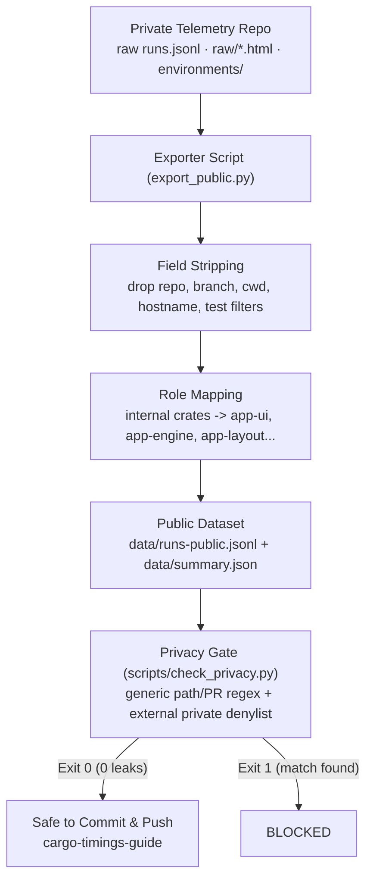

<p align="center">
  <a href="../README.md">← Cover</a> ·
  <a href="01-context-and-multi-agent-oom.md">Issue 01</a> ·
  <a href="02-storage-and-sccache-benchmarks.md">Issue 02</a> ·
  <a href="03-linker-and-profile-experiments.md">Issue 03</a> ·
  <strong>Issue 04</strong>
</p>

# Issue 04 · Publishing Real Cargo Telemetry Without Leaking Private Data

> *How we share 1,091 authentic Cargo benchmark records while guaranteeing zero proprietary names, paths, or test identifiers ever reach GitHub.*

---

## Why Raw Cargo Telemetry Cannot Be Made Public

Raw Cargo logs (`runs.jsonl`, `--timings` HTML reports, environment snapshots) inevitably capture sensitive operational details:

- Repository, branch, and worktree names (internal codenames, PR worktree tags)
- Test function names and CLI filter arguments
- Local usernames, hostnames, and filesystem mount paths (home directories and storage mounts)
- Full crate dependency graphs inside `--timings` HTML files

> [!CAUTION]
> **Never simply `.gitignore` sensitive files in an existing private repo and flip it to public.** Old Git commits still preserve every deleted path, branch name, and raw log in history.

---

## Our Two-Repository + Two-Layer Sanitization Pipeline



### What Gets Stripped vs. What Stays 100% Authentic

| Preserved (100% Real Cargo Data) | Stripped or Anonymized |
|---|---|
| `env_hash`, `subcommand`, `scope`, `xtask_kind` | `repo`, `branch`, `cwd`, `hostname`, `args` |
| Normalized flags (`--lib`, `--release`, `--all-targets`, `--timings`) | Test names & `--features=<redacted>` |
| `wall_ms`, `cpu_pct`, `max_rss_kb`, `queue_wait_ms` | Local paths (`$HOME`, storage mounts) |
| `sccache_hits`, `sccache_misses`, `exit_code`, UTC day/hour | Internal crate names → generic roles (`app-ui`, `app-engine`, `app-cli`) |

### The Self-Scanning Privacy Gate (`scripts/check_privacy.py`)

A subtle mistake in privacy scanners is **hardcoding the secret words inside the public scanner itself**—which leaks the very terms you wanted to hide!

Our [`scripts/check_privacy.py`](../scripts/check_privacy.py) avoids that trap completely:
1. Only **generic structural regexes** (Unix home paths, storage mount paths, Windows user paths, and PR worktree patterns) live in the public script.
2. Project-specific and machine-specific terms live in an **external denylist file** stored strictly inside the private repository (passed via `--denylist` or `CARGO_TIMINGS_DENYLIST`).
3. The scanner checks **every file in the public repo—including itself**.

```bash
# Always run before committing or pushing
python3 scripts/check_privacy.py
```

---

<p align="center">
  <a href="03-linker-and-profile-experiments.md">← Issue 03</a> ·
  <a href="../README.md">Back to Magazine Cover</a>
</p>
