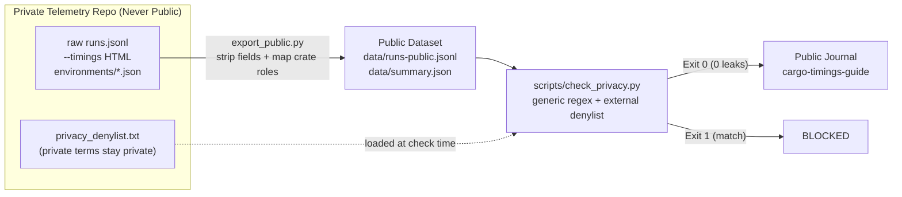

  <a href="../README.md">← Cover</a> ·
  <a href="01-context-and-multi-agent-oom.md">Issue 01</a> ·
  <a href="02-storage-and-sccache-benchmarks.md">Issue 02</a> ·
  <a href="03-linker-and-profile-experiments.md">Issue 03</a> ·
  <a href="04-24h-statistical-savings-model.md">Issue 04</a> ·
  <strong>Issue 05</strong>

# Issue 05 · Privacy-Preserving Cargo Telemetry & Reproducible Kit

> *How we publish 1,102 authentic Cargo telemetry records without leaking proprietary repo names, local paths, PR numbers, or test identifiers—plus the exact toolkit to run on your own machine.*

---

## 1 · Why Raw Cargo Telemetry Cannot Simply Be Made Public

Raw Cargo logs (`runs.jsonl`, `--timings` HTML reports, environment snapshots) inevitably capture sensitive operational details:

- Repository, branch, and worktree names (internal codenames, PR worktree tags)
- Test function names and CLI filter arguments
- Local usernames, hostnames, and filesystem mount paths (home directories and storage mounts)
- Full crate dependency graphs inside `--timings` HTML files

> [!CAUTION]
> **Never simply `.gitignore` sensitive files in an existing private repo and flip it to public.** Old Git commits still preserve every deleted path, branch name, commit message, and raw log in history.

---

## 2 · Our Two-Repository + Two-Layer Sanitization Architecture

### What Gets Stripped vs. What Stays 100% Real

| Preserved (100% Authentic Cargo Metrics) | Stripped or Anonymized |
|---|---|
| `env_hash`, `subcommand`, `scope`, `xtask_kind` | `repo`, `branch`, `cwd`, `hostname`, `args` |
| Normalized flags (`--lib`, `--release`, `--all-targets`, `--timings`) | Test names & `--features=<redacted>` |
| `wall_ms`, `cpu_pct`, `max_rss_kb`, `queue_wait_ms` | Local filesystem paths & usernames |
| `sccache_hits`, `sccache_misses`, `exit_code`, UTC day/hour | Internal crate names → generic roles (`app-ui`, `app-engine`, `app-layout`, `app-cli`) |

---

## 3 · The Self-Scanning Privacy Gate (`scripts/check_privacy.py`)

A classic mistake in open-source privacy scripts is **hardcoding the secret denylist directly inside the public scanner**—which immediately leaks the very terms you were trying to protect!

Our [`scripts/check_privacy.py`](../scripts/check_privacy.py) eliminates that failure mode:
1. Only **generic structural regexes** (Unix home paths, storage mount paths, Windows user paths, and PR worktree patterns) live in the public repository.
2. Project-specific and machine-specific terms live in an **external denylist file** inside the private repository (passed via `--denylist` or `CARGO_TIMINGS_DENYLIST`).
3. The scanner checks **every tracked file in the public repo—including itself**.

---

## 4 · Portable Reproducible Kit

Everything you need to run the same queue, telemetry, and statistical modeling on your own Rust workspace:

| Tool | What It Does | Quick Usage |
|---|---|---|
| [`kit/config.toml`](../kit/config.toml) | Winning `~/.cargo/config.toml` template (`mold` + SSD `sccache` + `line-tables-only` + `opt-level=0`) | Copy to `~/.cargo/config.toml` and replace `$HOME` |
| [`kit/cargo-timed-lite.sh`](../kit/cargo-timed-lite.sh) | Portable ~30-line `flock` single-queue + wall/RAM JSONL logger | `kit/cargo-timed-lite.sh nextest run -p my-crate --lib` |
| [`kit/analyze.py`](../kit/analyze.py) | Computes `p50`, `mean`, `p90`, `max`, RSS, and `sccache` hit rate by profile & subcommand | `python3 kit/analyze.py --scope focused` |
| [`kit/model_24h.py`](../kit/model_24h.py) | Runs 10,000-resample stratified bootstrap + $M/G/1$ queue analysis | `python3 kit/model_24h.py` |
| [`scripts/generate_charts.py`](../scripts/generate_charts.py) | Regenerates all 5 editorial SVG charts from `data/summary.json` | `python3 scripts/generate_charts.py` |
| [`scripts/check_privacy.py`](../scripts/check_privacy.py) | Automated zero-leak verification before any commit/push | `python3 scripts/check_privacy.py` |

---

  <a href="04-24h-statistical-savings-model.md">← Issue 04</a> ·
  <a href="../README.md">Back to Magazine Cover</a>

